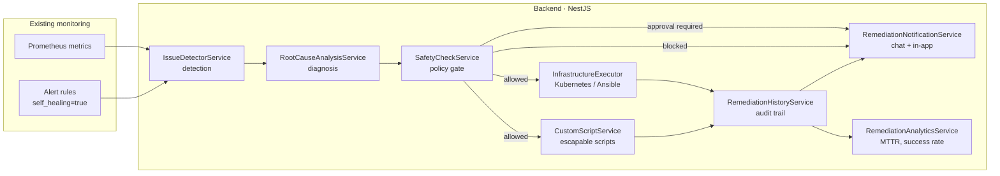

# Self-Healing Infrastructure

> Issue: #1194 · Labels: DevOps, backend, enhancement, quality, reliability

The self-healing engine detects infrastructure issues, diagnoses their root
cause and applies the remediation automatically — without waiting for a human
to notice the alert. Every automated action is safety checked, recorded for
audit and reported to the platform team.

The engine is **opt-in for production**. In staging it is enabled by default
so that a remediation can be validated before it is ever allowed to touch
production.

---

## 1. Goals and non-goals

| Goal | How it is measured |
| --- | --- |
| Detect common failures without human intervention | `self_healing_issues_detected_total` |
| Diagnose the actual cause, not just the symptom | `root_cause_confidence` per issue |
| Recover automatically where it is safe to do so | `self_healing_remediations_total{status="success"}` |
| Never perform a destructive action unattended | `remediation_actions.safety_decision = 'blocked'` |
| Keep a complete audit trail | `remediation_actions` table |
| Reduce the mean time to recovery | `GET /v1/admin/self-healing/analytics` |

**Non-goals.** The engine does not replace the on-call rotation, does not
change application code and never touches the ledger, the settlement jobs or
the database in production.

---

## 2. Architecture



The loop runs every five minutes (`SelfHealingSchedulerService`) and follows
the same path as a manual run through `POST /v1/admin/self-healing/cycle`:

```
detect → persist issue → diagnose → plan → safety check → execute → record → notify
```

---

## 3. Detection

Detection reuses the metrics that Prometheus already collects. Nothing is
scraped a second time.

### 3.1 Prometheus alerts

`devops/prometheus/self-healing-alerts.yaml` contains the alert rules of the
engine. Every rule carries three extra labels:

| Label | Meaning |
| --- | --- |
| `self_healing: "true"` | Marks the alert as eligible for remediation |
| `issue_type` | Classification used by the root cause analysis |
| `remediation` | The action the engine would apply |

The backend reads them through the Prometheus `/api/v1/alerts` API. Because
Prometheus applies the `for:` duration of a rule itself, an alert only becomes
an issue after it has been firing for the configured window. That window is
the dwell time that keeps the engine from reacting to short spikes.

### 3.2 Metric rules

Signals that are not (yet) expressed as an alert are covered by the code
rules in `backend/src/self-healing/detection/issue-detection-rules.ts`. Each
rule contains the current value query, the threshold, the dwell time and the
remediation that is attempted when the diagnosis does not suggest anything
more specific.

| Rule | Issue type | Threshold | Action |
| --- | --- | --- | --- |
| `pod-restart-loop` | `pod_restart_loop` | > 3 restarts / 15 min | `restart_pod` |
| `pod-not-ready` | `pod_failure` | not ready for 5 min | `restart_pod` |
| `deployment-replicas-unavailable` | `service_down` | > 0 unavailable | `restart_pod` |
| `container-memory-high` | `high_memory` | > 85 % of the limit | `restart_pod` |
| `container-memory-critical` | `high_memory` | > 95 % of the limit | `restart_pod` |
| `node-disk-full` | `disk_full` | < 10 % free | `cleanup_disk` |
| `node-disk-warning` | `disk_full` | < 20 % free | `cleanup_disk` |
| `node-memory-pressure` | `high_memory` | < 10 % available | escalation |
| `backend-error-rate` | `service_down` | > 1 × 5xx / s | `restart_service` |
| `backend-latency-p99` | `service_degradation` | p99 > 2 s | escalation |
| `rabbitmq-queue-backlog` | `queue_backlog` | > 500 messages | `scale_up` |
| `redis-memory-high` | `high_memory` | > 85 % of maxmemory | escalation |
| `db-connection-saturation` | `database_saturation` | > 85 % of max_connections | escalation |
| `pgbouncer-pool-high` | `database_saturation` | > 85 % pool utilisation | escalation |
| `certificate-expiring` | `certificate_expiry` | < 14 days | `custom_script` |

### 3.3 Deduplication

Every issue has a **fingerprint** (`<issue_type>:<target>`). A repeated
detection increments `occurrences` and updates `last_seen_at` instead of
creating a new row, so the history stays readable.

---

## 4. Root cause analysis

The diagnosis correlates the signal that triggered the issue with:

* container signals — restart count, last terminated reason, waiting reason;
* the recent remediation history of the same target — a target that was
  already remediated twice in the last hour is unlikely to be the cause;
* the metrics captured at detection time.

The rules live in `backend/src/self-healing/diagnosis/root-cause-rules.ts`.
The first rule whose conditions all match wins:

| Signature | Diagnosis | Confidence | Action |
| --- | --- | --- | --- |
| `lastTerminatedReason = OOMKilled` | Memory limit lower than the real footprint | 0.95 | `restart_pod` |
| `waitingReason = ImagePullBackOff` | Image cannot be pulled | 0.90 | escalation |
| `waitingReason = CrashLoopBackOff` | Application crashes on startup | 0.85 | `restart_pod` |
| `waitingReason = Unhealthy` | Liveness probe failing | 0.75 | `restart_pod` |
| memory ratio > 90 % | Memory limit too low | 0.80 | `restart_pod` |
| host filesystem < 10 % free | Disk full | 0.75 | `cleanup_disk` |
| queue backlog > 500 | Consumer throughput below the arrival rate | 0.70 | `scale_up` |
| connection pool > 85 % | Database pool saturated | 0.75 | escalation |
| no signature matched | Unknown, raw signal reported | 0.25 | escalation |

The diagnosis, the confidence and the collected evidence are stored on the
issue so that a reviewer can always see *why* an action was taken. When the
diagnosis needs a permanent fix (for example a memory limit that is too
low), the remediation is only a mitigation and the notification says so.

---

## 5. Remediation actions

| Action | What it does | Executor |
| --- | --- | --- |
| `restart_pod` | Deletes the pod; the deployment reschedules it | Kubernetes |
| `restart_service` | Triggers a rollout restart of a deployment | Kubernetes |
| `scale_up` / `scale_down` | Patches the scale subresource of a deployment | Kubernetes |
| `cleanup_disk` | Frees disk space (rotated logs, temporary files) | Ansible / script |
| `custom_script` | Runs a registered platform specific script | script runner |
| `manual` | Escalates to an operator, nothing is executed | — |

The executor is selected with `SELF_HEALING_EXECUTOR`:

* `kubernetes` (default) — talks to the API server with the in-cluster service
  account (`devops/k8s/self-healing-rbac.yaml` grants only `get`, `list`,
  `delete` on pods and `get`, `list`, `patch` on deployments);
* `ansible` — runs `devops/ansible/playbooks/self-healing-remediation.yml`
  for host level issues;
* `none` — a no-op executor that records every attempt without touching the
  infrastructure (useful to validate the pipeline).

When the active executor does not support an action (for example disk
cleanup through the Kubernetes API) the engine falls back to the remediation
script registered for the issue type.

---

## 6. Safety checks

No action is executed before `SafetyCheckService` approved it. The checks are
evaluated in the following order; a single hard block stops the action.

| # | Check | Result |
| --- | --- | --- |
| 1 | A policy exists for the action type | block |
| 2 | The policy is enabled | block |
| 3 | The policy allows the current environment | block |
| 4 | The script allows the current environment | block |
| 5 | `custom_script` has a registered script | block |
| 6 | The target is not a protected component (production) | block |
| 7 | The policy was validated in staging (production) | block |
| 8 | The hourly execution limit is not exceeded | block |
| 9 | The cooldown of the policy has elapsed | block |
| 10 | The replica count is inside the policy bounds | block |
| 11 | The policy requires an approval | approval |
| 12 | The action is destructive (production) | approval |
| 13 | The action is risky and the issue is critical (production) | approval |

**Protected components.** `ledger`, `settlement`, `database`, `postgres`,
`stellar` and `rabbitmq` are never remediated automatically in production.

**Destructive actions.** `cleanup_disk`, `scale_down` and scripts marked as
destructive always require an explicit approval in production. The action is
queued with the status `pending_approval` and an operator approves it with
`POST /v1/admin/self-healing/actions/{id}/approve`.

**Staging before production.** Every policy is created with
`staging_validated = false`, which blocks the action in production. The flag
is set automatically the first time the action succeeds in staging, so the
production rollout follows the tested path.

**Rate limiting.** A policy allows at most `max_executions_per_hour`
executions per target and enforces a `cooldown_minutes` window between two
executions of the same action.

### 6.1 Policies

| Policy | Action | Approval | Destructive | Limit | Cooldown |
| --- | --- | --- | --- | --- | --- |
| `restart-pod-default` | `restart_pod` | no | no | 10 / h | 5 min |
| `restart-service-default` | `restart_service` | yes | no | 3 / h | 30 min |
| `scale-up-default` | `scale_up` | no | no | 5 / h | 15 min |
| `scale-down-default` | `scale_down` | yes | yes | 2 / h | 30 min |
| `cleanup-disk-default` | `cleanup_disk` | yes | yes | 2 / h | 60 min |
| `custom-script-default` | `custom_script` | yes | yes | 3 / h | 30 min |

Policies are stored in the database and can be tuned at runtime with
`PATCH /v1/admin/self-healing/policies/{id}`.

---

## 7. History and audit

Every attempt — executed, approved, rejected, blocked or failed — is written
to `remediation_actions`:

| Column | Content |
| --- | --- |
| `action_type`, `target`, `component` | What was done and where |
| `status` | `pending_approval`, `approved`, `executing`, `success`, `failed`, `skipped`, `rejected` |
| `safety_decision`, `safety_reasons_json` | The verdict of the safety check and why |
| `policy_name` | The policy that was applied |
| `executed_by`, `trigger_source` | `system` or the operator id, `scheduler`, `api` or `manual` |
| `environment` | `staging` or `production` |
| `started_at`, `completed_at`, `duration_ms` | The execution window |
| `time_saved_ms` | The manual effort the action replaced |
| `output`, `error_message` | The result of the executor |

The audit trail is available at `GET /v1/admin/self-healing/history` and can
be filtered by status, action type, issue, target and time window.

---

## 8. Analytics

`GET /v1/admin/self-healing/analytics?hours=720` returns:

| Metric | Description |
| --- | --- |
| `successRate` | Successful actions / executed actions |
| `failureRate` | Failed actions / executed actions |
| `falsePositiveRate` | Issues that cleared without a remediation / all issues |
| `averageMttrMinutes` | Mean time from detection to recovery |
| `baselineMttrMinutes` | Manual baseline (`SELF_HEALING_BASELINE_MTTR_MINUTES`) |
| `mttrReductionPercent` | How much faster the recovery is than the manual baseline |
| `totalTimeSavedMinutes` | Manual effort that the automation replaced |
| `byActionType`, `byIssueType` | The same numbers grouped by action and issue type |

**MTTR impact.** The automation removes the detection-to-action delay: the
manual path is *alert → page → triage → execute*, the automated path is
*detect → diagnose → execute* inside the five minute cycle. With the
baseline of 120 minutes, a recovery that takes five minutes is a 95 %
reduction of the mean time to recovery — well beyond the 70 % target of the
issue.

The engine also exposes the following Prometheus metrics:

| Metric | Type | Labels |
| --- | --- | --- |
| `self_healing_issues_detected_total` | counter | `issue_type`, `severity` |
| `self_healing_remediations_total` | counter | `action_type`, `status` |
| `self_healing_active_issues` | gauge | `issue_type` |

---

## 9. Custom remediation scripts

Platform specific issues are handled with scripts that live in
`devops/scripts/self-healing/` and are registered in the database.

```bash
curl -X POST https://api.agri-fi.example.com/v1/admin/self-healing/scripts \
  -H "Authorization: Bearer $ADMIN_TOKEN" \
  -H 'Content-Type: application/json' \
  -d '{
        "name": "renew-certificate",
        "issueType": "certificate_expiry",
        "scriptPath": "renew-certificate.sh",
        "interpreter": "bash",
        "requiresApproval": true,
        "destructive": false,
        "allowedEnvironments": ["staging", "production"]
      }'
```

The runner enforces the following rules:

* the resolved path must stay inside `SELF_HEALING_SCRIPTS_DIR` — path
  traversal is rejected;
* the interpreter must be `bash`, `sh` or `python3`;
* arguments are passed as separate process arguments, never through a shell,
  and are restricted to a safe character set;
* the execution is bounded by `timeoutSeconds` (maximum 30 minutes);
* the script has to be enabled and registered before it can run.

A script is never executed because an alert asked for it — the safety policy
of the action type still applies.

---

## 10. Notifications

The engine notifies the platform team about every automated action:

* the chat webhook configured with `SELF_HEALING_ALERT_WEBHOOK_URL`
  (Slack compatible);
* the in-app notification feed of the operator configured with
  `SELF_HEALING_NOTIFY_USER_ID`;
* the system audit log (`audit_service.logEvent`).

Notifications are sent when an action starts, when it finishes and when it is
blocked or queued for approval. Set `SELF_HEALING_NOTIFICATIONS_ENABLED=false`
to mute them without disabling the automation.

---

## 11. Rollout

### 11.1 Staging

```bash
# 1. enable the engine in staging
export SELF_HEALING_ENABLED=true
export PROMETHEUS_URL=http://prometheus.staging.svc:9090

# 2. apply the RBAC and the alert rules
kubectl apply -f devops/k8s/self-healing-rbac.yaml
kubectl -n agri-fi exec deploy/agri-fi-backend -- true

# 3. run the validation
SELF_HEALING_API_URL=https://staging.api.agri-fi.example.com \
SELF_HEALING_API_TOKEN=$ADMIN_TOKEN \
PROMETHEUS_URL=http://prometheus.staging.svc:9090 \
./devops/scripts/self-healing-validate.sh
```

The validation checks the configuration, the API, the detection rules in
Prometheus, the policies, the history and the analytics.

### 11.2 Production

Production stays disabled until the team opts in:

```bash
SELF_HEALING_ENABLED=true
SELF_HEALING_EXECUTOR=kubernetes
```

The safety policy still blocks an action in production until it succeeded in
staging (`staging_validated`), so the production rollout can only enable
actions that were already exercised.

### 11.3 Chaos drill

A regular drill verifies that the engine still recovers a workload:

1. break a staging pod (`kubectl delete pod` on a healthy replica, or scale
   the deployment to zero for a few minutes);
2. wait for the detection cycle (≤ 5 minutes);
3. verify that the issue was detected, diagnosed and remediated;
4. verify that the notification arrived and that the analytics show a
   successful action.

---

## 12. Configuration

| Variable | Default | Description |
| --- | --- | --- |
| `SELF_HEALING_ENABLED` | `true` (non-production) | Master switch of the automation |
| `SELF_HEALING_EXECUTOR` | `kubernetes` | `kubernetes`, `ansible` or `none` |
| `SELF_HEALING_NAMESPACE` | `agri-fi` | Namespace of the platform workloads |
| `SELF_HEALING_ALERT_LABEL` | `self_healing` | Label that flags an alert |
| `SELF_HEALING_ACTION_TIMEOUT_MS` | `60000` | Timeout of a single action |
| `SELF_HEALING_MIN_REPLICAS` / `SELF_HEALING_MAX_REPLICAS` | `1` / `10` | Bounds used when scaling |
| `SELF_HEALING_BASELINE_MTTR_MINUTES` | `120` | Manual baseline for the analytics |
| `SELF_HEALING_SCRIPTS_DIR` | `devops/scripts/self-healing` | Allow-list directory of the scripts |
| `SELF_HEALING_ANSIBLE_PLAYBOOK` | `devops/ansible/playbooks/self-healing-remediation.yml` | Playbook of the Ansible executor |
| `SELF_HEALING_ALERT_WEBHOOK_URL` | – | Chat webhook for the notifications |
| `SELF_HEALING_NOTIFY_USER_ID` | – | Operator that receives the in-app notifications |
| `SELF_HEALING_NOTIFICATIONS_ENABLED` | `true` | Mute the notifications |
| `PROMETHEUS_URL` | `http://localhost:9090` | Prometheus used for the detection |
| `KUBERNETES_API_URL` | `https://kubernetes.default.svc` | API server of the Kubernetes executor |

---

## 13. API

All endpoints require an `admin` JWT and live under `/v1/admin/self-healing`.

| Method | Path | Description |
| --- | --- | --- |
| `GET` | `/status` | Automation status and environment |
| `GET` | `/issues` | Detected issues (paginated) |
| `GET` | `/issues/{id}` | Issue with its remediation actions |
| `POST` | `/issues/{id}/remediate` | Remediate an issue manually |
| `POST` | `/cycle` | Run a detection cycle immediately |
| `GET` | `/history` | Remediation history (audit trail) |
| `GET` | `/analytics` | Success rate, MTTR, false positives |
| `GET` | `/policies` | Safety policies |
| `PATCH` | `/policies/{id}` | Update a safety policy |
| `GET` | `/scripts` | Registered remediation scripts |
| `POST` | `/scripts` | Register a remediation script |
| `PATCH` | `/scripts/{id}` | Update a remediation script |
| `GET` | `/actions/{id}` | A single remediation action |
| `POST` | `/actions/{id}/approve` | Approve and execute a pending action |
| `POST` | `/actions/{id}/reject` | Reject a pending action |

---

## 14. Troubleshooting

| Symptom | Likely cause | Action |
| --- | --- | --- |
| No issue is detected | `SELF_HEALING_ENABLED` is `false` or Prometheus is unreachable | `GET /v1/admin/self-healing/status`, check `PROMETHEUS_URL` |
| The action is blocked with *not been validated in staging* | The policy never succeeded in staging | Run the action in staging, then check `staging_validated` |
| The action is blocked with *protected component* | The target belongs to a protected component | Remediate manually |
| The action requires an approval | The policy, the severity or the destructive flag demands it | `POST /v1/admin/self-healing/actions/{id}/approve` |
| The action is skipped by the cooldown | The same action ran recently on that target | Wait for the cooldown or lower `cooldownMinutes` |
| The script is refused | The path escapes the scripts directory or the interpreter is not allowed | Register the script with a path inside `SELF_HEALING_SCRIPTS_DIR` |

---

## 15. Related documentation

* `docs/monitoring/alert-map.md` — the alert inventory
* `devops/prometheus/self-healing-alerts.yaml` — the alert rules of the engine
* `devops/k8s/self-healing-rbac.yaml` — the least privilege RBAC
* `devops/ansible/playbooks/self-healing-remediation.yml` — the remediation playbook
* `devops/scripts/self-healing-validate.sh` — the staging validation
